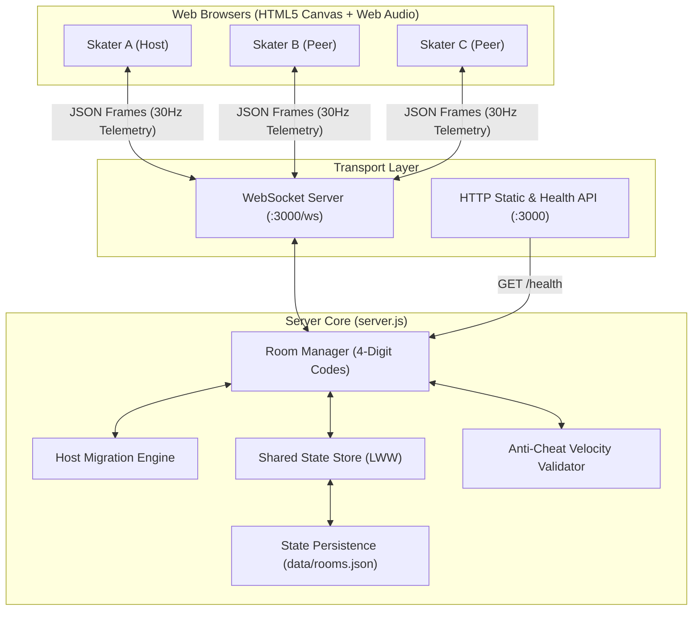

# 🛹 ALLEY RATS: SKATE & SPRAY — Realtime Multiplayer Web Game & Backend

[](https://nodejs.org/)
[](https://github.com/websockets/ws)
[-brightgreen.svg)](tests/integration.test.js)
[](LICENSE)
[](#-ps1-multiplayer-in-10-lines-solution)

> **SKATE. SPRAY. SEND IT.**  
> An urban skateboarding browser game inspired by British and American skate culture. Hang out in the alley, paint graffiti with friends on a shared live canvas, customize your skater and board, and race down obstacle-packed city streets with a live multiplayer leaderboard and resilient offline-recovery networking.

---

## ⚡ PS1: "Multiplayer in 10 Lines" Solution

In compliance with the Hackathon Problem Statement (**PS1: Multiplayer in 10 Lines**), any developer can add real-time rooms, shared state, presence, and live cursors to any web page using our drop-in library `Js/multiplayer.js`:

```javascript
// 10 lines to turn ANY web page into real-time multiplayer!
import { Multiplayer } from './Js/multiplayer.js';

const room = await Multiplayer.join({ roomId: 'ALLEY-01', name: 'Hawk' });
room.on('presence', (users) => console.log('Online skaters:', users));
room.on('cursor', ({ id, x, y, color }) => renderRemoteCursor(id, x, y, color));
room.on('state_change', (state) => updateSharedBoard(state));

window.addEventListener('mousemove', (e) => room.sendCursor(e.clientX, e.clientY));
document.getElementById('scoreBtn').onclick = () => room.setState('score', 100);
```

---

## 🎮 Core Game Features & 8 Gameplay Fixtures

### 1. The Alley Hangout Lobby
* **Realtime Skater Movement in Lobby**: Skaters can skate around the skatepark in real time using Arrow keys or WASD, pop ollies (`Space`), and kickflips (`K`). Remote skater positions (`normX`) are smoothly interpolated across all peers.
* **Shared Real-Time Graffiti Canvas**: Draw collaboratively on the brick alley wall with spray cans, markers, splatters, and stickers.
* **Clear Painted Wall**: A dedicated **CLEAR WALL** option wipes the canvas locally and broadcasts `graffiti_cleared` to reset the wall for all connected players simultaneously. Fresh rooms start with a clean wall.
* **Live Spray Cursors**: See each skater's colored spray can cursor with authentic rattle and spray particle effects.
* **Dynamic Crew Roster**: Live player list displaying skater names, custom spray colors, host badges, and ready status.
* **4-Digit Room Codes & Shareable Invite Links**: Create or join rooms via 4-character codes (e.g., `RAT-7421`) or direct URL query parameters (`?room=RAT-7421`).

### 2. The Urban Street Race
* **Deterministic Course Generation**: Shared RNG course seed ensures every racer encounters identical obstacles, collectibles, and cityscapes.
* **Real-Time Opponents on Track**: Remote opponent skater avatars are rendered dynamically ahead, alongside, or behind you. Includes exact distance delta pills (`[+28m]` in neon green if ahead, `[-14m]` in orange if behind) and off-screen directional edge indicators.
* **Interactive Obstacles**:
  * **Jump Hazards**: Jump over street bins, traffic cones, and parked cars (`Up` / `W` / `Space`).
  * **Duck Hazards**: Bow down/duck under low overhead street signs (`Down` / `S`).
  * **Launch Ramps**: Hit ramps to launch into high-altitude air tricks with bonus points.
  * **Grind Rails**: Snap onto grind rails for high-speed balance grinds and spark effects.
* **Glowing Neon Hazard Rays**: Pulsating neon hazard auras, vertical warning beacons, and action pills (`JUMP!`, `DUCK!`, `RAMP!`, `RAIL!`) give immediate visual feedback.
* **2 Lifelines per Skater**: Players start with 2 lifelines (`🛹 🛹`). Colliding with an obstacle diminishes a lifeline and triggers an invincibility recovery blink. Depleting both lifelines triggers a wipeout.
* **1-Minute Race with 35s Rush Escalation**: Races are capped at 60 seconds. After 35 seconds, difficulty scales dynamically up to $1.9\times$, obstacle spawn gaps tighten, base speed increases by $35\%$, and an on-screen warning flashes: `⚡ 35s FINAL RUSH! DIFFICULTY ESCALATING! ⚡`.
* **Vibrant Neon UI Title**: Stylish multi-stop neon gradients (`#39ff14` $\to$ `#00f0ff` $\to$ `#ff007f` $\to$ `#ffe600`) with comic drop shadows and glowing neon auras.

### 3. Network Resilience & Offline Reconnection
* **Accidental Disconnect Protection**: If a skater closes their tab or loses internet connection, the server flags them as AFK for a 60-second grace window rather than kicking them.
* **Seamless Offline Play**: The disconnected player can continue playing offline.
* **Reconnection Sync & Top Bar Pop-Up**: When connection restores, offline progress and score are automatically reconciled with the server. A top-bar notification announces: `⚡ [Player] reconnected! (+XXX pts recovered)`.
* **Host Migration**: If the room host leaves, host authority automatically migrates to the next oldest connected active player.
* **Zero-Crash Guard**: Process-level unhandled exception guards and guarded socket transmissions ensure 24/7 server stability.

---

## 🏛️ System Architecture



---

## 🚀 Quick Start Guide

### Prerequisites
* [Node.js](https://nodejs.org/) (v18.0.0 or higher)
* Modern web browser (Chrome, Firefox, Safari, Edge)

### 1. Installation
Clone the repository and install the single dependency (`ws`):
```bash
git clone https://github.com/<YOUR-USERNAME>/alley-rats-multiplayer.git
cd alley-rats-multiplayer
npm install
```

### 2. Run Automated Integration Tests
Verify the complete end-to-end WebSocket stack before starting:
```bash
npm test
```
*Runs all 18 automated tests covering health checks, room creation, peer joins, shared state sync, graffiti streaming, race countdown, and offline reconnection.*

### 3. Start the Server
```bash
npm start
```
The server will boot on port 3000:
* **Game URL**: [http://localhost:3000](http://localhost:3000)
* **WebSocket Endpoint**: `ws://localhost:3000/ws`
* **Health Check**: [http://localhost:3000/health](http://localhost:3000/health)

---

## ⌨️ Controls & Keybindings

### Alley Hangout Lobby
| Action | Key / Input |
|---|---|
| **Move Skater Left / Right** | `A` / `D` or `Left` / `Right` Arrow |
| **Push Skateboard** | Tap movement key repeatedly |
| **Pop Ollie** | `Spacebar` or `W` or `Up` Arrow |
| **360 Kickflip** | `K` key |
| **Spray Graffiti** | Click and drag with mouse |
| **Change Spray Tool** | Select `SPRAY`, `MARKER`, `BRUSH`, `STICKER` |
| **Clear Wall** | Click **CLEAR WALL** button |

### Street Race
| Action | Key / Input |
|---|---|
| **Jump Over Obstacles** | `Spacebar` / `W` / `Up` Arrow |
| **Duck Under Signs** | Hold `S` / `Down` Arrow |
| **Grind Rail** | Jump onto a grind rail to snap into grinding |
| **Launch Ramp** | Skate into a ramp for high-altitude air |
| **Pause Game** | `Escape` key |

---

## 📁 Repository Structure

```text
alley-rats-multiplayer/
├── index.html                      # Main game interface, 1600x900 canvas, HUD, modals
├── server.js                       # WebSocket & HTTP backend server (zero crash, persistence)
├── package.json                    # Project metadata & npm scripts
├── .gitignore                      # Git ignore rules (node_modules, data/rooms.json, logs)
│
├── Css/                            # Modular Urban Graffiti Stylesheets
│   ├── style.css                   # Global reset, typography, and color variables
│   ├── menu.css                    # Main menu screen, neon title styling
│   ├── lobby.css                   # Skatepark graffiti wall & crew roster
│   ├── racing.css                  # Gameplay HUD, lifelines, speedometer, leaderboard
│   ├── customization.css           # Skater deck, grip tape, wheels & spray picker modal
│   └── settings.css                # Audio, graphics, control bindings & accessibility
│
├── Js/                             # Vanilla ES6 JavaScript Engine & Networking
│   ├── config.js                   # Client configuration and physics constants
│   ├── app.js                      # Application bootstrap and state machine coordinator
│   ├── audio.js                    # Procedural Web Audio API sound synthesizer
│   ├── multiplayer.js              # Standalone drop-in client SDK (10-line multiplayer)
│   ├── multiplayer-adapter.js      # Bridge between SDK, game events, and UI
│   ├── racing-network.js           # 20Hz racing telemetry sync engine
│   ├── recovery-manager.js         # Offline recovery, reconnect state & AFK accumulator
│   ├── scenes.js                   # Scene manager (MENU, CUSTOMIZATION, LOBBY, RACING)
│   ├── renderer.js                 # 1600x900 virtual canvas scaling & DPR pipeline
│   ├── skater.js                   # Vector skater rig, ollies, kickflips, interpolation
│   ├── physics.js                  # 2D arcade physics (gravity, jumps, ducks, boost, grind)
│   ├── obstacles.js                # Interactive obstacles, duck signs, neon rays & ramps
│   ├── collectibles.js             # Spray cans, Golden Rat trophies, nitro boost stars
│   ├── surprise-events.js          # Urban humor events (Duck, Inflatable Dino, Tiny Dog)
│   ├── racing.js                   # Main race loop (60s timer, 35s rush, 2 lifelines, opponents)
│   ├── scoring.js                  # Checkpoints, trick combos, multiplier & meter distance
│   ├── leaderboard.js              # Real-time multi-player HUD ranking & delta meters
│   ├── menu.js                     # Menu controller & room code form validation
│   ├── lobby.js                    # Lobby crew roster & spray tools controller
│   ├── graffiti.js                 # Shared multiplayer graffiti wall canvas engine
│   ├── cursors.js                  # Live remote spray can / marker cursors
│   ├── customization.js            # Character & board customization manager
│   ├── settings.js                 # Local user preferences manager
│   └── storage.js                  # LocalStorage wrapper for offline state
│
├── docs/                           # Detailed Architecture & Technical Specifications
│   ├── BACKEND_SPECIFICATION.md    # WebSocket protocol, packets catalog, host migration
│   ├── MULTIPLAYER_LIBRARY_SDK.md  # Client library API contract & quick-start guide
│   ├── API_AND_DATA_SCHEMAS.md     # TypeScript interfaces & JSON schemas
│   └── PROJECT_ARCHITECTURE.md     # Virtual coordinate system & rendering pipeline
│
└── tests/                          # Automated Testing Suite
    └── integration.test.js         # 18-stage end-to-end WebSocket integration test
```

---

## 📚 Technical Documentation Index

Detailed markdown specifications are provided in the [`docs/`](docs/) directory:

1. **[Backend Architecture & Server Specification](docs/BACKEND_SPECIFICATION.md)**: Detailed breakdown of the WebSocket wire protocol, packet catalog, host migration, and rate limiting.
2. **[Multiplayer Client Library SDK Specification](docs/MULTIPLAYER_LIBRARY_SDK.md)**: Public API signatures for `window.Multiplayer`, event listeners, and shared state management.
3. **[API & Data Schemas (TypeScript & JSON Schema)](docs/API_AND_DATA_SCHEMAS.md)**: Strict schemas for PlayerState, RoomState, GraffitiStroke, Telemetry, and ReconcilePayload.
4. **[Project Architecture & Game Engine Blueprint](docs/PROJECT_ARCHITECTURE.md)**: Canvas scaling, 16:9 virtual resolution, Web Audio procedural sound generation, and state machine transitions.

---

## 📄 License
This project is open-source under the [MIT License](LICENSE).
