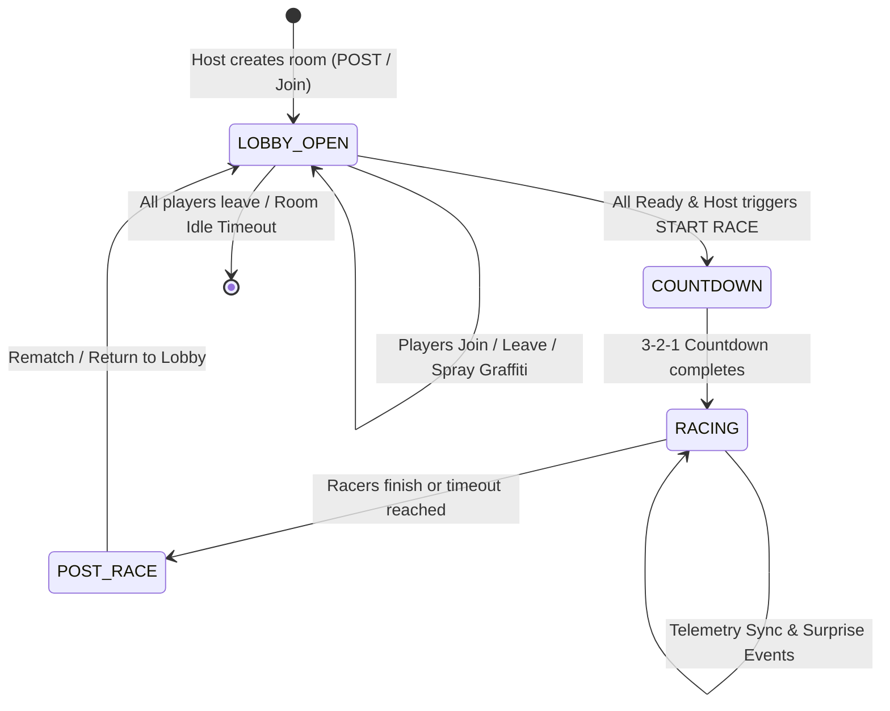

# ALLEY RATS: SKATE & SPRAY — Backend Architecture & Server Specification

## 1. Executive Summary

**Alley Rats: Skate & Spray** is an urban multiplayer skateboarding browser game. The game runs on a unified 16:9 Canvas viewport and features two distinct multiplayer phases:

1. **Phase 1: The Alley Hangout Lobby (Graffiti & Skate Jam)**
   - Shared, synchronized graffiti canvas with real-time spray strokes, markers, brushes, and sticker stamps.
   - Remote mouse/spray cursor broadcasting with custom colors and cursor styles.
   - 2D side-view skater physics (skating, ollies, kickflips, 50-50 grinds).
   - Dynamic player roster with character/skateboard customization synchronization.
   - Host controls, readiness toggling, and race countdown triggering.

2. **Phase 2: The Urban Street Race (Main Racing Gameplay)**
   - High-speed side-scrolling cartoon skateboard racing through street, alley, and skatepark sectors.
   - Synchronized course generation seed (ensuring all players encounter identical obstacles, ramps, grinds, and collectibles).
   - Throttled real-time racer position and distance broadcasts (20–30 Hz or checkpoint-based).
   - Shared surprise events (e.g., Giant Rubber Duck, Pigeon Swarm, Oil Slicks).
   - Live multiplayer dynamic leaderboard with positions, scores, speeds, and ping indicators.
   - Resilient offline progress recovery and authoritative server reconciliation in case of network drops.

This document specifies the backend server architecture, communication protocol, room lifecycle, packet schemas, and security/anti-cheat validation rules required to build the production backend.

---

## 2. Server Architecture & Protocols

```
┌─────────────────────────────────────────────────────────────────┐
│                       Load Balancer (TLS)                       │
└─────────────────────────────────┬───────────────────────────────┘
                                  │
         ┌────────────────────────┴────────────────────────┐
         │                                                 │
┌────────▼─────────────────────┐         ┌─────────────────▼─────────────┐
│  HTTP / REST API (Port 3000)  │         │  WebSocket Server (Port 3000) │
│  - Health checks             │         │  - Full duplex JSON frames    │
│  - Room status queries       │         │  - Sub-50ms latency tick      │
│  - Offline progress sync     │         │  - Room pub/sub distribution  │
└────────┬─────────────────────┘         └─────────────────┬─────────────┘
         │                                                 │
         └────────────────────────┬────────────────────────┘
                                  │
┌─────────────────────────────────▼───────────────────────────────┐
│              In-Memory Room State & Redis Cache                 │
│  - Active Rooms & Players       - Graffiti Stroke History       │
│  - Race Seeds & Checkpoints     - Live Leaderboard Roster       │
└─────────────────────────────────────────────────────────────────┘
```

### 2.1 Transport Layer
- **WebSocket (`ws://` / `wss://`)**: Primary communication channel for real-time bidirectional messaging (cursors, graffiti strokes, race telemetry, player readiness).
- **HTTP/REST (Optional / Fallback)**: Used for health checks (`GET /health`), room info inspection (`GET /api/rooms/:roomId`), and asynchronous offline reconciliation (`POST /api/reconcile`).

### 2.2 Server Requirements
- **Tick Rate**:
  - Lobby Cursor updates: Broadcast at ~25 Hz (every 40ms) with delta compression.
  - Lobby Graffiti strokes: Immediate streaming or batched at 45ms.
  - Race Progress Telemetry: Client broadcasts at 3.3 Hz (every 300ms) or on checkpoint events; Server interpolates and rebroadcasts.
- **Maximum Room Capacity**: 8 skaters per room (configurable in `config.js`).
- **Target Latency**: < 60ms round-trip time for regional servers.

---

## 3. Room Lifecycle & State Machine



### 3.1 Room Creation & Join Rules
1. **Room ID Format**: 4–8 alphanumeric characters (e.g., `RAT-7421`, `SKATE-99`).
2. **First Connected Client**: Automatically assigned as `isHost: true`.
3. **Host Migration**: If the host disconnects during lobby or race, the server promotes the next oldest connected player to `isHost = true` and emits `players_updated`.
4. **Room Teardown**: An empty room is maintained for a 60-second grace period before being garbage-collected from server memory.

---

## 4. WebSocket Message Catalog

All WebSocket messages follow a standard JSON envelope:

```typescript
interface NetworkPacket<T = any> {
  type: string;           // Event identifier (e.g. 'cursor', 'race_progress')
  roomId: string;         // Unique room code
  playerId?: string;      // ID of sender (injected by server for security)
  seq?: number;           // Sequential packet number for deduplication
  timestamp: number;      // Epoch ms when emitted
  payload: T;             // Event-specific data
}
```

---

### 4.1 Lobby Phase Events

#### 1. `client_connect` (Client -> Server)
Sent immediately upon WebSocket handshake to register player credentials and avatar customization.
```json
{
  "type": "client_connect",
  "roomId": "RAT-7421",
  "timestamp": 1729160000000,
  "payload": {
    "name": "NEON_VIPER",
    "customization": {
      "name": "NEON_VIPER",
      "skinTone": "#ffd1a4",
      "headwear": "beanie",
      "headwearColor": "#ff007f",
      "hairColor": "#1e1b18",
      "hoodieColor": "#7c3aed",
      "hoodieGraphic": "rat",
      "pantsColor": "#1e293b",
      "shoesColor": "#f8fafc",
      "deckGraphic": "flame",
      "deckColor": "#0f172a",
      "wheelColor": "#39ff14",
      "cursorType": "spray-can",
      "paintColor": "#8CFF57",
      "brushSize": 12
    }
  }
}
```

#### 2. `connected` (Server -> Client)
Sent back to confirm connection, assigning a server-verified `clientId` and initial state.
```json
{
  "type": "connected",
  "roomId": "RAT-7421",
  "timestamp": 1729160000050,
  "payload": {
    "clientId": "usr_9f8a3d1c",
    "isHost": true,
    "state": {
      "roomId": "RAT-7421",
      "players": {
        "usr_9f8a3d1c": {
          "id": "usr_9f8a3d1c",
          "name": "NEON_VIPER",
          "ready": false,
          "isHost": true,
          "customization": { ... }
        }
      },
      "lobby": {
        "graffiti": []
      },
      "race": {
        "status": "waiting"
      }
    }
  }
}
```

#### 3. `player_ready` (Client -> Server)
Toggles the player's readiness state in the lobby.
```json
{
  "type": "player_ready",
  "roomId": "RAT-7421",
  "payload": {
    "ready": true
  }
}
```
*Server Broadcast*: Server updates player record and broadcasts `players_updated` to all room peers.

#### 4. `cursor` (Client -> Server -> Peers)
Normalized cursor coordinate (0.0 to 1.0) on the virtual 1600x900 canvas.
```json
{
  "type": "cursor",
  "roomId": "RAT-7421",
  "payload": {
    "clientId": "usr_9f8a3d1c",
    "x": 0.452,
    "y": 0.381,
    "cursorType": "spray-can",
    "color": "#8CFF57",
    "name": "NEON_VIPER"
  }
}
```
*Handling*: Throttled to max 25 Hz. Server broadcasts to all other peers in the room excluding the sender.

#### 5. `graffiti_stroke` (Client -> Server -> Peers)
A finished or active batch of spray points within the wall boundary (`wallBounds`: `x: 0.02..0.98`, `y: 0.08..0.72`).
```json
{
  "type": "graffiti_stroke",
  "roomId": "RAT-7421",
  "payload": {
    "strokeId": "stroke_1729160012345_01",
    "clientId": "usr_9f8a3d1c",
    "tool": "spray-can",
    "color": "#35D7FF",
    "size": 14,
    "points": [
      { "x": 0.341, "y": 0.220 },
      { "x": 0.345, "y": 0.224 },
      { "x": 0.352, "y": 0.231 }
    ],
    "stickerId": null
  }
}
```
*Persistence*: The server appends valid strokes to `room.state.lobby.graffiti` (capped at 500 strokes) so newly connecting players receive the complete canvas art.

#### 6. `graffiti_cleared` (Client -> Server -> Peers)
Initiated by host or vote to wipe the graffiti wall.
```json
{
  "type": "graffiti_cleared",
  "roomId": "RAT-7421",
  "payload": {}
}
```
*Handling*: Server wipes `room.state.lobby.graffiti = []` and broadcasts `graffiti_cleared` to all clients.

---

### 4.2 Racing Phase Events

#### 1. `start_race` (Client -> Server)
Triggered by the room host when ready criteria are satisfied.
```json
{
  "type": "start_race",
  "roomId": "RAT-7421",
  "payload": {}
}
```
*Server Action*: Server validates sender is host. Generates a deterministic `courseSeed` (e.g. `133742`) and initiates countdown.

#### 2. `race_countdown` (Server -> All Clients)
Instructs clients to display the 3-2-1 countdown overlay and preload racing assets.
```json
{
  "type": "race_countdown",
  "roomId": "RAT-7421",
  "payload": {
    "countdownSeconds": 3,
    "raceId": "race_1729160500",
    "courseSeed": 948123,
    "trackLength": 1500
  }
}
```

#### 3. `race_progress` (Client -> Server -> All Clients)
Broadcast by racers every 300ms or on passing 100m checkpoints.
```json
{
  "type": "race_progress",
  "roomId": "RAT-7421",
  "payload": {
    "raceId": "race_1729160500",
    "playerId": "usr_9f8a3d1c",
    "name": "NEON_VIPER",
    "color": "#8CFF57",
    "distance": 348.5,
    "speed": 46.2,
    "score": 1420,
    "combo": 2,
    "checkpoint": 3,
    "status": "racing",
    "timestamp": 1729160520100
  }
}
```
*Server Action*: Server maintains an authoritative racer leaderboard sorted by:
`1. status === 'finished' (by completion time)`
`2. distance descending`
`3. score descending`
Broadcasts updated leaderboard snapshots to all clients.

#### 4. `surprise_event` (Server -> All Clients or Client -> Server)
Synchronizes dynamic surprise obstacles (Giant Rubber Duck, Pigeon Swarm, Oil Slick).
```json
{
  "type": "surprise_event",
  "roomId": "RAT-7421",
  "payload": {
    "eventId": "event_duck_01",
    "type": "GIANT_DUCK",
    "title": "🦆 GIANT RUBBER DUCK!",
    "subtitle": "Watch out for the squeaky monster!",
    "triggerDistance": 450,
    "duration": 6000
  }
}
```

#### 5. `race_finish` (Client -> Server)
Sent when a racer crosses the finish line (`distance >= trackLength`).
```json
{
  "type": "race_finish",
  "roomId": "RAT-7421",
  "payload": {
    "raceId": "race_1729160500",
    "playerId": "usr_9f8a3d1c",
    "completionTime": 48.32,
    "finalScore": 9850,
    "totalTricks": 14,
    "collectiblesCollected": 9
  }
}
```

---

## 5. Offline Recovery & Reconciliation Protocol

Network instability must not break a player's race or invalidate their legitimate progress.

### 5.1 Local Client Persistence
The client's `RecoveryManager` (`js/recovery-manager.js`) continuously serializes the active race state to `localStorage` under `alley_rats_race_recovery_v1`:
- `raceId`, `playerId`, `sessionId`
- `distance`, `score`, `checkpoint`
- `collectibles` (set of collected item IDs)
- `lastEventSequence`, `timestamp`

### 5.2 Reconciliation Packet: `reconcile_progress`
Upon reconnecting after an internet drop, the client sends:
```json
{
  "type": "reconcile_progress",
  "roomId": "RAT-7421",
  "payload": {
    "raceId": "race_1729160500",
    "playerId": "usr_9f8a3d1c",
    "distance": 810.0,
    "score": 4200,
    "checkpoint": 8,
    "lastEventSequence": 42,
    "timestamp": 1729160580000
  }
}
```

### 5.3 Server Validation Rules
The server executes the following anti-cheat validation checks:
1. **Plausible Velocity Check**:
   $$\text{Max Allowed Distance} = d_{\text{last}} + v_{\text{max}} \times (t_{\text{now}} - t_{\text{disconnect}})$$
   If reported distance exceeds maximum theoretical speed ($75 \text{ km/h} \approx 20.8 \text{ m/s}$), distance is clamped to max allowable.
2. **Score-to-Trick Ratio**:
   Validates that points claimed are within allowable bounds for tricks and collectibles recorded between checkpoints.
3. **Response**:
```json
{
  "type": "reconcile_response",
  "roomId": "RAT-7421",
  "payload": {
    "accepted": true,
    "raceId": "race_1729160500",
    "playerId": "usr_9f8a3d1c",
    "acceptedDistance": 810.0,
    "acceptedScore": 4200,
    "checkpoint": 8,
    "serverTimestamp": 1729160580120
  }
}
```

---

## 6. Security, Rate Limiting & Anti-Cheat

| Vector | Risk | Mitigation |
|---|---|---|
| **Cursor Flood** | Client floods WebSocket with mouse moves | Server rate limits cursor messages to 30 packets/sec per connection; drops excessive packets. |
| **Graffiti Memory Bomb** | Client emits 10,000 dense strokes | Enforce max 100 points per stroke; clamp coordinate range (`0.0 <= x, y <= 1.0`); limit room canvas history to 500 strokes. |
| **Teleportation / Speed Hack** | Racer submits instant 1500m distance | Validate maximum acceleration and top speed ($21 \text{ m/s}$). Reject or clamp impossible jumps. |
| **Name / Chat Spoofing** | Profanity, injection, or identity theft | Sanitize skater name strings (max 16 chars, alphanumeric, strip HTML tags/script injection). |
| **Unauthorized Race Start** | Non-host triggers race start | Verify `client.isHost === true` before processing `start_race`. |

---

## 7. Recommended Production Stack

- **Runtime**: Node.js (v18+) or Bun / Go.
- **WebSocket Engine**: `ws` or `uWebSockets.js` for lightweight high-throughput performance.
- **State Store**: In-memory Map for active rooms; Redis for multi-instance pub/sub and distributed room discovery.
- **Monitoring**: Prometheus metrics (`connected_sockets`, `active_rooms`, `packets_per_second`).
